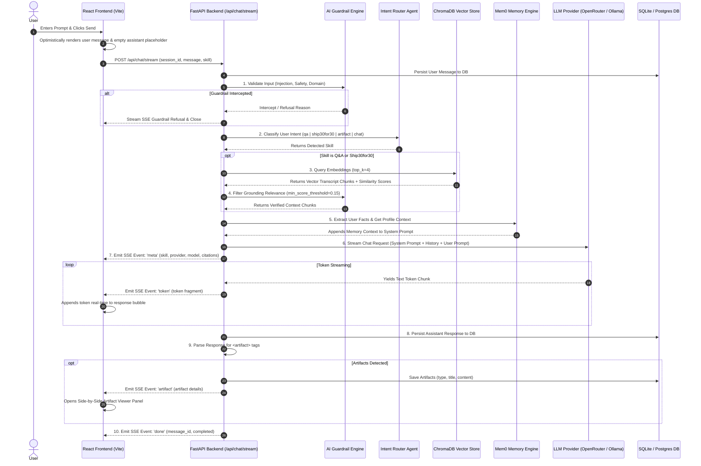

# 📘 Comprehensive System Architecture & End-to-End Technical Flow Document

> **Project**: The Lenny Growth Assistant (`RAG_with_Podcast`)  
> **Repository Root**: [`d:\Pinhead`](file:///d:/Pinhead)  
> **Generated Date**: August 2, 2026  

---

## 🎯 Executive Summary & Core Concept

**The Lenny Growth Assistant** is an agentic, full-stack conversational web application engineered to ingest, index, and synthesize knowledge from **390+ episodes** of *Lenny's Podcast* (over **27,400 indexed transcript chunks**).

The application serves product managers, growth leaders, and founders by providing:
1. **Strictly Grounded Q&A**: Answers product management & growth questions backed by actual guest transcripts with explicit citations.
2. **Ship30for30 Atomic Essays**: Automatically formats complex growth insights into structured ~1,250-word atomic essays (hook, 3-5 core pillars, skimmable bullet points, actionable takeaways).
3. **Interactive Live Artifacts**: Generates HTML/CSS components, UI mockups, SVG graphics, and Markdown documents rendered side-by-side in an interactive split-screen workspace.
4. **Dual LLM Engine Support**: Dynamically switches between **Cloud LLMs** (via OpenRouter API, e.g. Claude 3.5 Sonnet, GPT-4o-mini) and **Local LLMs** (via Ollama, e.g. Llama 3, Qwen 2.5) with zero server restarts.
5. **Mem0 Long-Term User Memory**: Extracts user role, background, tech stack, and preferences from conversation turns and injects them across sessions.
6. **AI Safety & Topic Guardrails**: Detects prompt injection attempts, blocks off-topic query noise, and filters low-relevance vector chunks to eliminate hallucinations.

---

## 🔄 End-to-End Execution Sequence Flow

The following diagram and step-by-step breakdown describe what happens from the millisecond a user types a prompt into the frontend to when the final token and artifact render on screen.

### 📊 Visual Flowchart (Mermaid)



---

## 🛠️ Step-by-Step Technical Breakdown

### Step 1: User Request Input (Frontend)
- **File**: [`frontend/src/components/ChatWindow.jsx`](file:///d:/Pinhead/frontend/src/components/ChatWindow.jsx), [`frontend/src/context/ChatContext.jsx`](file:///d:/Pinhead/frontend/src/context/ChatContext.jsx)
- The user enters a message in the input textarea and can optionally pick a specialized skill pill (`Auto-Detect`, `Lenny Q&A`, `Ship30for30 Essay`, `Interactive Artifact`).
- The frontend immediately creates an optimistic message bubble in React state and fires an HTTP POST request to `/api/chat/stream`.

### Step 2: Session Resolution & Persistence (FastAPI)
- **File**: [`backend/app/main.py`](file:///d:/Pinhead/backend/app/main.py#L220-L245)
- The backend retrieves the active `SessionModel` from the database.
- The user's input prompt is immediately persisted in the database as a `MessageModel` (role="user").

### Step 3: AI Safety & Guardrails Evaluation
- **File**: [`backend/app/agents/guardrails.py`](file:///d:/Pinhead/backend/app/agents/guardrails.py)
- **Prompt Injection Defense**: Scans input against regex patterns targeting system prompt leakage, DAN jailbreaks, or filter bypasses.
- **Content Filter**: Blocks prohibited or dangerous content requests.
- **Domain Relevance Check**: Gently redirects off-topic queries (e.g. medical advice, cooking recipes) back to product management and growth.
- *If triggered*: The engine instantly streams a friendly guardrail refusal response via SSE and halts further processing.

### Step 4: Provider & Model Resolution
- **File**: [`backend/app/llm/manager.py`](file:///d:/Pinhead/backend/app/llm/manager.py)
- The engine determines whether to call **OpenRouter API** or **Ollama Local**:
  1. Per-request override (from UI pill header).
  2. Runtime setting stored in `settings.json` (`"active_provider"`).
  3. Environment fallback (`ACTIVE_PROVIDER`).

### Step 5: Intent Router Classification
- **File**: [`backend/app/agents/router.py`](file:///d:/Pinhead/backend/app/agents/router.py)
- If the user selected a skill explicitly, that skill is used.
- Otherwise, the fast heuristic pattern classifier checks for explicit keywords (`ship30for30`, `atomic essay`, `artifact`, `html`, `css`, `ui mockup`).
- If heuristics are inconclusive, a lightweight zero-shot LLM call classifies the message into one of four intent categories:
  - `qa`: Grounded Q&A against podcast transcripts.
  - `ship30for30`: Atomic growth essay generation.
  - `artifact`: Code, UI mockup, or markdown document artifact.
  - `chat`: General conversational response.

### Step 6: RAG Vector Retrieval & Grounding Score Filter
- **Files**: [`backend/app/rag/retriever.py`](file:///d:/Pinhead/backend/app/rag/retriever.py), [`backend/app/rag/chroma_store.py`](file:///d:/Pinhead/backend/app/rag/chroma_store.py), [`backend/app/rag/embeddings.py`](file:///d:/Pinhead/backend/app/rag/embeddings.py)
- For `qa` and `ship30for30` skills:
  1. The user query is converted into a **384-dimensional vector embedding** using SentenceTransformers (`all-MiniLM-L6-v2`).
  2. ChromaDB runs an HNSW cosine similarity search against the **27,400+ indexed podcast transcript chunks**.
  3. Top 4 candidate chunks are returned along with guest names and episode titles.
  4. `verify_grounding_relevance()` applies a minimum cosine score threshold (`0.15`) to discard low-relevance chunks and eliminate hallucinations.

### Step 7: Mem0 User Memory Extraction & Context Injection
- **File**: [`backend/app/agents/user_memory.py`](file:///d:/Pinhead/backend/app/agents/user_memory.py)
- **Fact Extraction**: The engine scans incoming messages for user profile statements (e.g. *"I am a Senior PM at a B2B SaaS company"*, *"We build a developer tool"*).
- Extracted facts are stored persistently in [`backend/user_memories.json`](file:///d:/Pinhead/backend/user_memories.json).
- **Prompt Injection**: The entire stored user profile is injected into the system prompt so the LLM tailors answers to the user's role and domain across sessions.

### Step 8: System Prompt Construction & SSE Token Streaming
- **File**: [`backend/app/main.py`](file:///d:/Pinhead/backend/app/main.py#L308-L365), [`backend/app/agents/prompts.py`](file:///d:/Pinhead/backend/app/agents/prompts.py)
- The system prompt is constructed by assembling:
  1. Core Skill System Prompt (`LENNY_QA_SYSTEM_PROMPT`, `SHIP30FOR30_SYSTEM_PROMPT`, or `ARTIFACT_GENERATOR_SYSTEM_PROMPT`).
  2. Grounded Transcript Context (formatted with Guest and Episode headers).
  3. Mem0 User Profile Context.
  4. Conversation History (up to the last 10 messages).
- The engine emits an initial SSE `event: meta` containing citations, active provider, model, and skill.
- As tokens arrive from the LLM provider stream, they are emitted in real time as `event: token` SSE events.

### Step 9: Artifact Extraction & Persistent Storage
- **File**: [`backend/app/agents/artifact_parser.py`](file:///d:/Pinhead/backend/app/agents/artifact_parser.py)
- Once the full response completes, `extract_artifacts_from_text()` scans the output for custom tags:
  ```xml
  <artifact type="html" title="Growth Funnel Calculator">
  <!-- Code or Markdown Content -->
  </artifact>
  ```
- If an artifact tag is parsed, it is saved in the database (`ArtifactModel`) and emitted to the frontend as an `event: artifact` SSE payload.
- The frontend [`ArtifactViewer.jsx`](file:///d:/Pinhead/frontend/src/components/ArtifactViewer.jsx) catches the event and opens a side-by-side split screen view with live rendering or sandboxed iframe preview.

### Step 10: Finalization & State Update
- The full assistant response is stored in `MessageModel` (role="assistant").
- If the chat session title is "New Conversation", the engine auto-titles the session based on the first prompt snippet.
- The server emits `event: done` and closes the SSE stream.

---

## 🏛️ Subsystem Architecture & Component Matrix

| Subsystem | Primary Files | Tech Stack / Tooling | Purpose |
| :--- | :--- | :--- | :--- |
| **Frontend UI** | [`App.jsx`](file:///d:/Pinhead/frontend/src/App.jsx), [`ChatWindow.jsx`](file:///d:/Pinhead/frontend/src/components/ChatWindow.jsx), [`ArtifactViewer.jsx`](file:///d:/Pinhead/frontend/src/components/ArtifactViewer.jsx) | React 18, Vite, Lucide Icons, Glassmorphism CSS | Workspace layout, SSE stream listener, side-by-side artifact renderer |
| **API Server** | [`main.py`](file:///d:/Pinhead/backend/app/main.py), [`config.py`](file:///d:/Pinhead/backend/app/config.py) | FastAPI, Uvicorn, SSE Starlette | Async REST endpoints and Server-Sent Event streaming pipeline |
| **Database** | [`models.py`](file:///d:/Pinhead/backend/app/db/models.py), [`database.py`](file:///d:/Pinhead/backend/app/db/database.py) | SQLAlchemy 2.0 (Async), SQLite / PostgreSQL | Persistent storage of sessions, messages, artifacts, and chunks |
| **Vector RAG** | [`chroma_store.py`](file:///d:/Pinhead/backend/app/rag/chroma_store.py), [`ingestor.py`](file:///d:/Pinhead/backend/app/rag/ingestor.py), [`embeddings.py`](file:///d:/Pinhead/backend/app/rag/embeddings.py) | ChromaDB, SentenceTransformers (`all-MiniLM-L6-v2`) | Semantic indexing and vector search across 27.4k transcript passages |
| **LLM Provider Factory** | [`manager.py`](file:///d:/Pinhead/backend/app/llm/manager.py), [`openrouter_provider.py`](file:///d:/Pinhead/backend/app/llm/openrouter_provider.py), [`ollama_provider.py`](file:///d:/Pinhead/backend/app/llm/ollama_provider.py) | OpenRouter REST API, Ollama Local Daemon | Unified async streaming interface for Cloud & Local LLMs |
| **Agent Guardrails & Routing** | [`guardrails.py`](file:///d:/Pinhead/backend/app/agents/guardrails.py), [`router.py`](file:///d:/Pinhead/backend/app/agents/router.py) | Regex, Zero-shot LLM Classification | Safety filtering, prompt injection defense, and intent classification |
| **Mem0 User Memory** | [`user_memory.py`](file:///d:/Pinhead/backend/app/agents/user_memory.py) | JSON File Storage, Pattern Heuristics | Extracting and injecting long-term user facts across sessions |
| **Logging & Diagnostics** | [`logger.py`](file:///d:/Pinhead/backend/app/logger.py), [`LogsModal.jsx`](file:///d:/Pinhead/frontend/src/components/LogsModal.jsx) | Python Logging, RotatingFileHandler | Real-time system log streaming to web UI drawer & disk |

---

## 🔌 API SSE Data Contracts

### 1. Initial Meta Event (`event: meta`)
```json
{
  "event": "meta",
  "data": {
    "session_id": "8f4a1c0d-3e2b-4d9a-9c7b-1a2b3c4d5e6f",
    "skill": "ship30for30",
    "provider": "openrouter",
    "model": "anthropic/claude-3.5-sonnet",
    "citations": [
      {
        "guest": "Shreyas Doshi",
        "episode": "Good Product Manager vs Bad Product Manager",
        "score": 0.842
      }
    ]
  }
}
```

### 2. Token Streaming Event (`event: token`)
```json
{
  "event": "token",
  "data": {
    "token": "Product-market fit is not a static destination..."
  }
}
```

### 3. Artifact Generation Event (`event: artifact`)
```json
{
  "event": "artifact",
  "data": {
    "id": "art-9921",
    "type": "html",
    "title": "Retention Curve Calculator Widget",
    "content": "<!DOCTYPE html><html>...</html>"
  }
}
```

### 4. Completion Event (`event: done`)
```json
{
  "event": "done",
  "data": {
    "message_id": "msg-5512",
    "status": "completed"
  }
}
```

---

## ⚙️ Configuration File Structure (`settings.json`)

Runtime settings are saved in [`settings.json`](file:///d:/Pinhead/settings.json) and hot-reloaded dynamically whenever updated via the UI Settings Drawer without requiring a backend server restart:

```json
{
  "active_provider": "openrouter",
  "openrouter": {
    "api_key": "sk-or-v1-YOUR_OPENROUTER_KEY",
    "default_model": "anthropic/claude-3.5-sonnet",
    "available_models": [
      "anthropic/claude-3.5-sonnet",
      "openai/gpt-4o-mini",
      "meta-llama/llama-3.3-70b-instruct"
    ]
  },
  "ollama": {
    "base_url": "http://localhost:11434",
    "default_model": "llama3:latest"
  },
  "database": {
    "url": "sqlite+aiosqlite:///./lenny_db.sqlite"
  }
}
```

---

## 💡 Summary of System Capabilities

1. **Deterministic Grounding**: Every podcast answer is backed by exact guest passages stored in ChromaDB.
2. **Zero-Restart Engine Switch**: Switch between Cloud models (Claude 3.5 Sonnet, GPT-4o-mini) and Local models (Ollama Llama 3) seamlessly.
3. **Live Sandbox Execution**: Code and UI mockups generated inside `<artifact>` tags immediately load in a side-by-side sandboxed preview window.
4. **Autonomous User Personalization**: Long-term memory remembers facts across sessions to customize insights for your company, role, and tech stack.
5. **Production-Grade Safety**: Full-layer guardrails block jailbreaks, prompt injection, and off-topic hallucinated queries.
